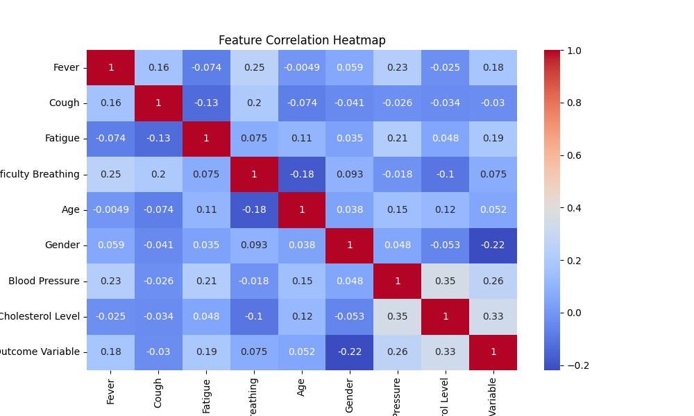
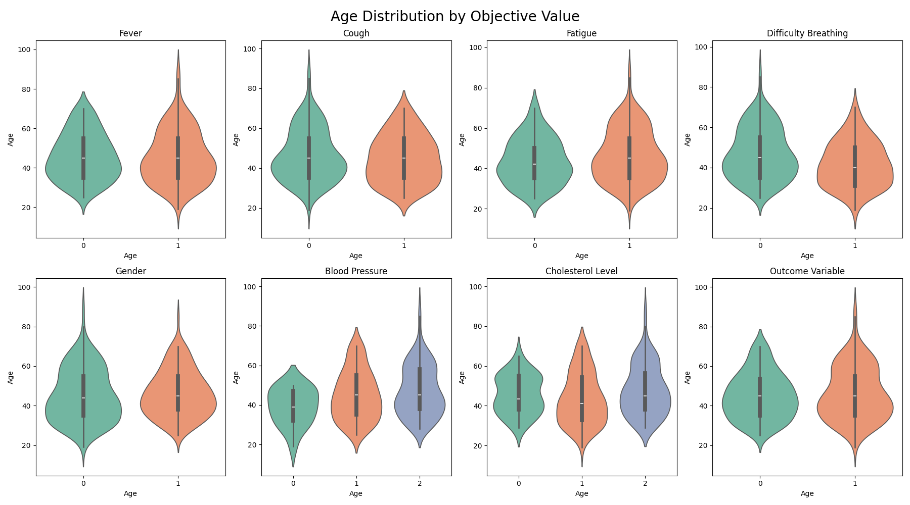

<!--
SPDX-FileCopyrightText: 2025 Group-3_RSE_TeamProject
SPDX-License-Identifier: CC0-1.0
-->

# Disease Symptom and Patient Profile Analysis

## Giving Credit

This project was developed as part of the **Research Software Engineering (RSE)** course at TU Dresden for the [Continuous Integration/Continuous Deployment (CI/CD) Exercise](https://bildungsportal.sachsen.de/opal/auth/RepositoryEntry/48793518083).  
It is based on the lectures and materials provided by **Guido Juckeland**, **Katja Lisa Linnemann**, and **Fredo Erxleben**.


---

## Purpose of this Repository

This repository implements a full machine learning and data analysis pipeline to explore a dataset containing patient profiles and their reported disease symptoms. It provides:

- Data loading and preprocessing
- Exploratory Data Analysis (EDA) and visualizations
- Model training and evaluation using various ML algorithms
- Streamlit dashboard for interactive exploration
- Unit tests and CI pipeline
- Formatting and license compliance checks

**Main Tasks Completed:**

- **Project Setup**  
    Initialized with `.gitignore`, `README.md`, `LICENSE`, and `pyproject.toml`.

- **Dependency Management**  
    Managed using `pyproject.toml` and `uv.lock`.

- **Data Pipeline**  
    Modular functions for loading, cleaning, and preprocessing.

- **Exploratory Data Analysis (EDA)**  
    Generates plots like correlation heatmaps and age-based violin distributions.

- **Machine Learning Pipeline**  
    Trains and tunes models (e.g., Random Forest, Logistic Regression, SVM) with hyperparameter search.

- **Model Evaluation**  
    Uses metrics like AUC, MCC, Sensitivity, and Specificity on train and test splits.

- **Streamlit Dashboard**  
    Interactive app to view the dataset, visualize EDA insights, and showcase trained ML model performance directly in the browser.

- **Automated Testing**  
    Uses `pytest` to validate preprocessing and ML steps.

- **CI/CD Integration**  
    The GitLab CI/CD pipeline is configured to perform automated linting, testing, artifact generation, and project deployment, including public API exposure and result publication.

- **Code Quality & Compliance**  
    Formatted using `black`, `isort`, and verified with `reuse lint`.

- **Artifact Management**  
    Output plots and metrics saved to `results/`.

- **Ready for Extension**  
    Suitable for documentation, packaging (e.g., PyPI), and archiving (e.g., Zenodo).

---

## Project Outline and Data

Dataset:  
[disease-symptoms-and-patient-profile-dataset](https://www.kaggle.com/datasets/uom190346a/disease-symptoms-and-patient-profile-dataset)

### Features:
- Demographics: Age, Gender  
- Symptoms: Fever, Cough, Fatigue, Difficulty Breathing  
- Clinical: Blood Pressure, Cholesterol Level  
- Outcome: Test result (Positive/Negative)

---

## Visual Summary

### Correlation Heatmap



The heatmap shows how features like **Fever**, **Blood Pressure**, and **Fatigue** correlate with the outcome variable.

### Age Distribution by Symptom



Violin plots show age trends across symptoms and patient profiles. Notably, patients with severe symptoms skew older.

---

## Model Evaluation Snapshot

### Models Evaluated
Logistic Regression, Decision Tree, Random Forest, Support Vector Machine (SVM), Naive Bayes, K-Nearest Neighbors (KNN), and Gradient Boosting.

### Evaluation Metrics
- **AUC** (Area Under the Curve): Measures classifier quality
- **MCC** (Matthews Correlation Coefficient): Balanced performance across imbalanced data
- **Sensitivity**: True Positive Rate (Recall)
- **Specificity**: True Negative Rate
- **MAE, MSE, RMSE**: Error metrics on classification probability confidence

---

### Insights

-  **Random Forest** and **Gradient Boosting** achieved the best AUC and MCC scores, making them strong candidates for deployment.
-  **Logistic Regression** was the most consistent and interpretable model with decent generalization performance (AUC: 0.78, MCC: 0.52).
-  **Naive Bayes** and **SVM** showed lower specificity and MCC, indicating limited reliability in distinguishing classes.
-  **Gradient Boosting** showed perfect training performance, hinting at possible overfitting despite strong test performance.


---

## Streamlit Dashboard

Launch the interactive web app locally:

```bash
streamlit run app.py
```

### Features:
- View the preprocessed dataset
- Run and view EDA plots
- Train models and see metrics in real-time

---

## Set Up Project

### Clone

```bash
git clone https://codebase.helmholtz.cloud/tud-rse-pojects-2025/group-3.git
```

### Install uv

```bash
pip install --upgrade pip
pip install uv
```

### Install Dependencies

```bash
uv venv
source .venv/bin/activate
uv sync --group dev --active --frozen
```

---

## Run EDA and ML Modules (CLI)

```bash
uv run python src/eda.py
uv run python src/ml_models.py
```

---

## Run Tests

```bash
uv run pytest src/test_pipeline_models.py
```

---

## Code Quality Checks

### License Compliance

```bash
uv run reuse lint
```

### Code Style

```bash
uv run isort --check --diff src/
uv run black --check --diff src/
```

---

## Contributors

- Prerana Chandratre  
- Biswajyoti Roy
- Anjali Sharma

---

## License

Please see [LICENSE.md](LICENSE.md) for license information.

---

## Publications

Please checkout our publications on:
- PYPI Test: https://test.pypi.org/project/disease-analysis/0.1.0/ 
- Zenodo Sandbox:  https://sandbox.zenodo.org/records/279783 
- DOI: <a href="https://handle.stage.datacite.org/10.5072/zenodo.279783"></a>

---
